# prospera components: what each one is, holds and looks like

Generated by `node harness/scripts/component-catalog.mjs` on 2026-10-27 from the code, Sitecore and the base site. Do not edit by hand: re-run it.
Use it to choose (or swap, R1) the component for a section: a section with pictures needs Image fields, a video needs a component that plays one, several cards need a list.

| Component | Category | Kind | Images | Links | Rich text | Video | Placeholders | Variants (screenshot) |
|---|---|---|---|---|---|---|---|---|
| [ArticleDetails](#articledetails) | Articles | context | 0 | 0 | 0 | no | `page-navigation`, `article-meta`, `background-page-content`, `page-content` | Default ✓, Simple |
| [AuthorDetails](#authordetails) | Articles | context | 0 | 0 | 0 | no | `page-navigation`, `background-page-content`, `page-content` | Default, Simple |
| [Carousel](#carousel) | Banners | list | 2 | 1 | 1 | yes | none | Default ✓ |
| [CtaBanner](#ctabanner) | Banners | simple | 2 | 1 | 1 | no | none | Default ✓, LargeImage ✓ |
| [HeadingCta](#headingcta) | Banners | simple | 0 | 1 | 0 | no | none | Default ✓, Compact ✓, PageHeading ✓, Centered ✓ |
| [Hero](#hero) | Banners | simple | 1 | 1 | 1 | no | none | Default ✓ |
| [HeroBanner](#herobanner) | Banners | simple | 2 | 2 | 1 | no | `hero-banner` | Default ✓ |
| [ParallaxBanner](#parallaxbanner) | Banners | simple | 2 | 1 | 1 | no | none | Default ✓ |
| [PromoCta](#promocta) | Banners | simple | 1 | 2 | 1 | no | `promo-cta` | Default ✓, WithPlaceholderColumn ✓, WithBackgroundImage ✓ |
| [AppPromo](#apppromo) | Calls to action | simple | 1 | 0 | 1 | no | none | Default ✓ |
| [FiveColumnCta](#fivecolumncta) | Calls to action | simple | 5 | 5 | 0 | no | none | Default ✓ |
| [FourColumnCta](#fourcolumncta) | Calls to action | simple | 4 | 4 | 0 | no | none | Default ✓ |
| [ThreeColumnCta](#threecolumncta) | Calls to action | simple | 3 | 3 | 0 | no | none | Default ✓, WithIcons ✓, WithIconsCompact ✓ |
| [TwoColumnCta](#twocolumncta) | Calls to action | simple | 2 | 2 | 0 | no | `two-col-placeholder-left`, `two-col-placeholder-right` | Default ✓ |
| [Comparison](#comparison) | Content | simple | 0 | 0 | 0 | no | none | Default ✓ |
| [DocumentsList](#documentslist) | Content | simple | 4 | 4 | 0 | no | none | Default ✓ |
| [Features](#features) | Content | simple | 1 | 1 | 1 | no | none | Default ✓ |
| [ImageGallery](#imagegallery) | Content | list | 1 | 0 | 0 | no | none | Default ✓ |
| [Quote](#quote) | Content | simple | 1 | 0 | 0 | no | none | Default ✓, Simple ✓ |
| [RichText](#richtext) | Content | simple | 0 | 0 | 1 | no | none | Default ✓ |
| [StatsCounter](#statscounter) | Content | simple | 2 | 0 | 0 | no | none | Default ✓ |
| [ApplicationForm](#applicationform) | Forms and tools | simple | 0 | 1 | 2 | no | none | Default ✓ |
| [ContactForm](#contactform) | Forms and tools | simple | 1 | 0 | 0 | no | none | Default ✓ |
| [LoanCalculator](#loancalculator) | Forms and tools | simple | 0 | 0 | 0 | no | none | Default ✓ |
| [Accordion](#accordion) | Lists | list | 1 | 0 | 1 | no | none | Default ✓ |
| [ArticleList](#articlelist) | Lists | context | 0 | 0 | 0 | no | none | Default ✓, ThreeColumn, Simplified ✓, Grid |
| [AuthorList](#authorlist) | Lists | context | 0 | 0 | 0 | no | none | Default ✓, Slider, Simple |
| [AuthorWidget](#authorwidget) | Lists | simple | 4 | 3 | 0 | no | none | Default ✓, WithSocials ✓ |
| [ProjectList](#projectlist) | Lists | context | 0 | 0 | 0 | no | none | Default, Mosaic |
| [Questions](#questions) | Lists | list | 0 | 0 | 1 | no | none | Default ✓, SingleColumn ✓ |
| [Testimonials](#testimonials) | Lists | list | 1 | 0 | 0 | no | none | Default ✓ |
| [ProjectDetails](#projectdetails) | Projects | context | 0 | 0 | 0 | no | `project-additional-content` | Default |

Kind: **simple** = one datasource item · **list** = a datasource item with child items · **context** = reads the page (no datasource).
Screenshots come from the showcase pages under `/components/` (`component-showcase.mjs`: each component alone, on its template's sample text) where one exists, else from the first base-site page that uses the component and variant. **Grey boxes are images**: the base site's media host did not serve them when the screenshots were taken.

## ArticleDetails

| | |
|---|---|
| Kind | context |
| Code | `src/components/pagecontent/ArticleDetails.tsx` |
| Rendering | `/sitecore/layout/Renderings/Project/Financial/Articles/Article Details` `a7343c454438441e967ec2cb350dda75` |
| Datasource template | none (reads the page or its children) |
| Can show | 0 image field(s), 0 link field(s), 0 rich text field(s) |
| On the base site | `/articles/introducing-mobile-finance`, `/articles/beware-of-financial-online-scams`, `/articles/exploring-the-use-of-blockchain-technology`, `/articles/empowering-young-adults`, `/articles/closing-the-wealth-gap` |

**Fields read by the code** (no datasource template): Title (Field<string>), Excerpt (Field<string>), Content (RichTextField), Thumbnail (ImageField), BackgroundImage (ImageField), Name (Field<string>), Photo (ImageField), Position (Field<string>)

**Rendering parameters** (layout options, never visitor text): Include in schema

**Placeholders** (other components can be added inside it in Pages; empty, they show only while editing, not in the screenshots)

- `page-navigation` (after BackgroundImage, before Thumbnail): Default; not in Simple
- `article-meta` (after Thumbnail, before Title): Default; not in Simple
- `background-page-content` (after Content): every variant
- `page-content` (after Content): every variant
- `article-meta` (after Content): Simple; not in Default

**Variants**

*Default* (from `/articles/introducing-mobile-finance`)

*Simple*: not placed on the base site, no screenshot

Notes: Context item resolver {6CCCBCDE-5E95-44E4-AE66-CFE7D3A0589E}. Code variant Simple has no Variant Definition.

## AuthorDetails

| | |
|---|---|
| Kind | context |
| Code | `src/components/pagecontent/AuthorDetails.tsx` |
| Rendering | `/sitecore/layout/Renderings/Project/Financial/Articles/Author Details` `f7bb574ae5c14475a07e0ebf590cc50e` |
| Datasource template | none (reads the page or its children) |
| Can show | 0 image field(s), 0 link field(s), 0 rich text field(s) |
| On the base site | `/authors/Josephine Baxter`, `/authors/Nick Reddick`, `/authors/Olly Damon`, `/authors/Patricia Ball`, `/authors/Gabby Ross` |

**Fields read by the code** (no datasource template): Name (Field<string>), Position (Field<string>), Photo (ImageField), Bio (RichTextField), BackgroundImage (ImageField)

**Rendering parameters** (layout options, never visitor text): Include in schema

**Placeholders** (other components can be added inside it in Pages; empty, they show only while editing, not in the screenshots)

- `page-navigation` (after BackgroundImage, before Photo): Default; not in Simple
- `background-page-content` (after Bio): Default; not in Simple
- `page-content` (after Bio): Default; not in Simple

**Variants**

*Default*: not placed on the base site, no screenshot

*Simple*: not placed on the base site, no screenshot

Notes: Context item resolver {6CCCBCDE-5E95-44E4-AE66-CFE7D3A0589E}. A second rendering DoctorDetails {0CB90097-6A6D-46F3-AB94-F2406435F689} also sets componentName AuthorDetails and was not given its own entry.

## Carousel

Rotating slides with title, text, image and link; optional video; dots or arrows.

| | |
|---|---|
| Kind | list (registry id `carousel`) |
| Code | `src/components/pagecontent/Carousel.tsx` |
| Rendering | `/sitecore/layout/Renderings/Project/Financial/Page Content/Carousel` `8094185b4c7240c8b005c6ed91708754` |
| Datasource template | `/sitecore/templates/Project/Financial/Components/Carousel` `c7b8468f4290400f93bbd46c5f8db126` |
| Datasource location | `query:$site/*[@@name='Data']/*[@@templatename='Carousel']` or `query:$sharedSites/*[@@name='Data']/*[@@templatename='Carousel']` |
| Can show | 2 image field(s), 1 link field(s), 1 rich text field(s), video, a list of child items |
| On the base site | `/` |

**Fields read by the code** (no datasource template): Title (Field<string>), Text (RichTextField), Image (ImageField), Link (LinkField), Video (ImageField)

**Child items: Carousel Item** (`/sitecore/templates/Project/Financial/Components/Carousel Item`)

| Field | Type |
|---|---|
| Title | Single-Line Text |
| Text | Rich Text |
| Link | General Link |
| Image | Image |
| Video | Image |

**Rendering parameters** (layout options, never visitor text): Include in schema

**Variants**

*Default* (from `/components/carousel`)

Notes: Candidate local template {C7B8468F-4290-400F-93BB-D46C5F8DB126} and candidate child Carousel Item {54DB209D-CD0F-49D9-AE4E-ECB65D72CC4D} were not assigned because the branch item is missing. Children resolver {2F5C334E-5615-423C-8281-9FC180191302}.

## CtaBanner

Conversion band near the bottom of a page; eyebrow, title, text and a single action; image or icon on one side.

| | |
|---|---|
| Kind | simple (registry id `cta-banner`) |
| Code | `src/components/pagecontent/CtaBanner.tsx` |
| Rendering | `/sitecore/layout/Renderings/Project/Financial/Page Content/CTA Banner` `488b8ac00ef94f6f871178ba182b2c4c` |
| Datasource template | `/sitecore/templates/Project/Financial/Components/CTA Banner` `4900d7e561b0483aa9d669419d4d5982` |
| Datasource location | `query:$site/*[@@name='Data']/*[@@templatename='CTA Banner']` or `query:$sharedSites/*[@@name='Data']/*[@@templatename='CTA Banner']` |
| Can show | 2 image field(s), 1 link field(s), 1 rich text field(s) |

**Fields**

| Field | Type | From |
|---|---|---|
| Eyebrow | Single-Line Text | CTA Banner / Data |
| Title | Single-Line Text | CTA Banner / Data |
| Text | Rich Text | CTA Banner / Data |
| Link | General Link | CTA Banner / Data |
| Image | Image | CTA Banner / Data |
| Icon | Image | CTA Banner / Data |

**Rendering parameters** (layout options, never visitor text): Include in schema

**Variants**

*Default* (from `/components/cta-banner`)

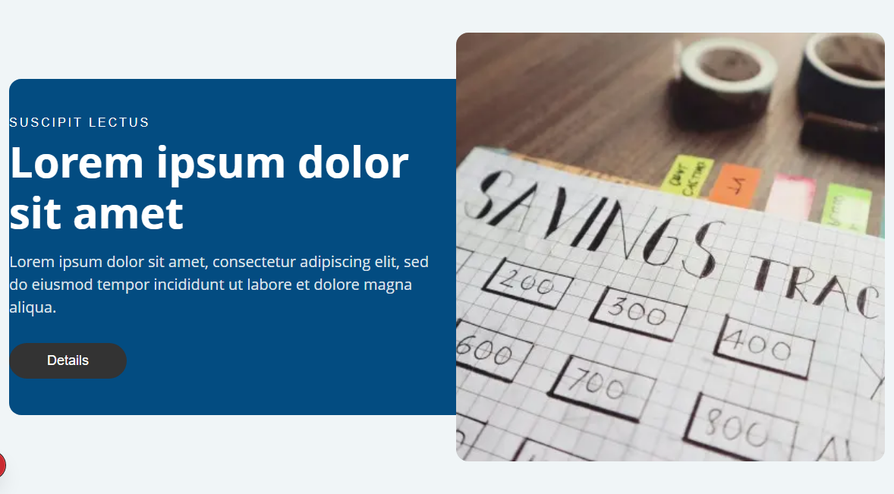

*LargeImage* (from `/components/cta-banner`)

Notes: Registered on Available Renderings/Custom Demo, not Page Content.

## HeadingCta

Section or page heading with eyebrow, text and one link; centered heading strip; page title bar.

| | |
|---|---|
| Kind | simple (registry id `heading-cta`) |
| Code | `src/components/pagecontent/HeadingCta.tsx` |
| Rendering | `/sitecore/layout/Renderings/Project/Financial/Page Content/Heading CTA` `89e1d5477cd64ef09a271e99410797dd` |
| Datasource template | `/sitecore/templates/Project/Financial/Components/Heading CTA` `fa1365276302471d83abe66fc72bda99` |
| Datasource location | `query:$site/*[@@name='Data']/*[@@templatename='Heading CTA']` or `query:$sharedSites/*[@@name='Data']/*[@@templatename='Heading CTA']` |
| Can show | 0 image field(s), 1 link field(s), 0 rich text field(s) |

**Fields**

| Field | Type | From |
|---|---|---|
| Eyebrow | Single-Line Text | Heading CTA / Data |
| Heading | Single-Line Text | Heading CTA / Data |
| Text | Multi-Line Text | Heading CTA / Data |
| Link | General Link | Heading CTA / Data |

**Rendering parameters** (layout options, never visitor text): Include in schema

**Variants**

*Default* (from `/components/heading-cta`)

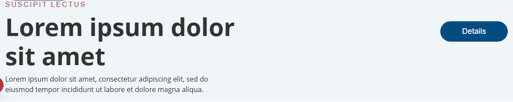

*Compact* (from `/components/heading-cta`)

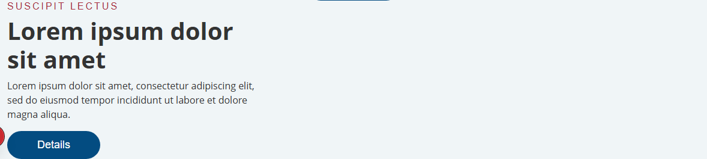

*PageHeading* (from `/components/heading-cta`)

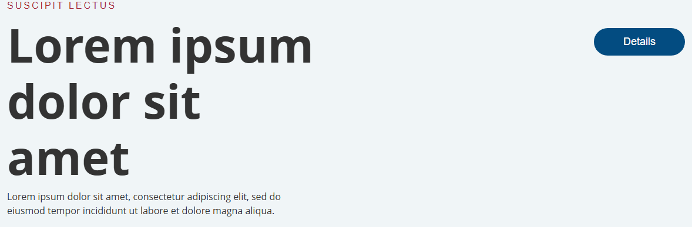

*Centered* (from `/components/heading-cta`)

Notes: Registered on Available Renderings/Custom Demo, not Page Content.

## Hero

Simple intro with title, text, one link and an image; lighter alternative to the hero banner.

| | |
|---|---|
| Kind | simple (registry id `hero`) |
| Code | `src/components/pagecontent/Hero.tsx` |
| Rendering | `/sitecore/layout/Renderings/Project/Financial/Page Content/Hero` `b7cdf75e716a4c59b9b1cd970ae0a4ae` |
| Datasource template | `/sitecore/templates/Project/Financial/Components/Hero` `90d315e8aa424b23a7eb4491396453f8` |
| Datasource location | `query:$site/*[@@name='Data']/*[@@templatename='Hero']` or `query:$sharedSites/*[@@name='Data']/*[@@templatename='Hero']` |
| Can show | 1 image field(s), 1 link field(s), 1 rich text field(s) |

**Fields**

| Field | Type | From |
|---|---|---|
| Title | Single-Line Text | Hero / Data |
| Text | Rich Text | Hero / Data |
| Image | Image | Hero / Data |
| Link | General Link | Hero / Data |

**Rendering parameters** (layout options, never visitor text): Include in schema

**Variants**

*Default* (from `/components/hero`)

Notes: Field types read from Hero/Data field items.

## HeroBanner

Large headline with small eyebrow tagline above; body text and one or two buttons; image beside or behind the headline; main intro section at the top of a page.

| | |
|---|---|
| Kind | simple (registry id `hero-banner`) |
| Code | `src/components/pagecontent/HeroBanner.tsx` |
| Rendering | `/sitecore/layout/Renderings/Project/Financial/Page Content/HeroBanner` `0e8cc47e32d64f55a7bfe713abd06323` |
| Datasource template | `/sitecore/templates/Project/Financial/Components/HeroBanner` `0089bcb3011743f2a7600771d5ff7417` |
| Datasource location | `query:$site/*[@@name='Data']/*[@@templatename='HeroBanner']` or `query:$sharedSites/*[@@name='Data']/*[@@templatename='HeroBanner']` |
| Can show | 2 image field(s), 2 link field(s), 1 rich text field(s) |

**Fields**

| Field | Type | From |
|---|---|---|
| Tagline | Single-Line Text | HeroBanner / Data |
| Title | Single-Line Text | HeroBanner / Data |
| Text | Rich Text | HeroBanner / Data |
| Image | Image | HeroBanner / Data |
| Cta1 | General Link | HeroBanner / Data |
| Cta2 | General Link | HeroBanner / Data |
| Icon | Image | HeroBanner / Data |
| QuickOrderLink | General Link | HeroBanner / Quick Order |
| QuickOrderText | Single-Line Text | HeroBanner / Quick Order |
| QuickOrderTitle | Single-Line Text | HeroBanner / Quick Order |

**Template fields the code does not render** (filling them shows nothing): QuickOrderLink, QuickOrderText, QuickOrderTitle

**Rendering parameters** (layout options, never visitor text): Include in schema

**Placeholders** (other components can be added inside it in Pages; empty, they show only while editing, not in the screenshots)

- `hero-banner` (after Cta2, before Icon): every variant

**Variants**

*Default* (from `/components/hero-banner`)

Notes: Field types read from HeroBanner/Data field items.

## ParallaxBanner

Full-width banner with background and foreground image; parallax scrolling effect; title with short text and one link.

| | |
|---|---|
| Kind | simple (registry id `parallax-banner`) |
| Code | `src/components/pagecontent/ParallaxBanner.tsx` |
| Rendering | `/sitecore/layout/Renderings/Project/Financial/Page Content/Parallax Banner` `200920ad96454cb2b72ac7d8278e709f` |
| Datasource template | `/sitecore/templates/Project/Financial/Components/Parallax Banner` `28b7f396dc4a41168c933b7909cbeb0e` |
| Datasource location | `query:$site/*[@@name='Data']/*[@@templatename='Parallax Banner']` or `query:$sharedSites/*[@@name='Data']/*[@@templatename='Parallax Banner']` |
| Can show | 2 image field(s), 1 link field(s), 1 rich text field(s) |

**Fields**

| Field | Type | From |
|---|---|---|
| Title | Single-Line Text | Parallax Banner / Data |
| Text | Rich Text | Parallax Banner / Data |
| Link | General Link | Parallax Banner / Data |
| BackgroundImage | Image | Parallax Banner / Data |
| ForegroundImage | Image | Parallax Banner / Data |

**Rendering parameters** (layout options, never visitor text): Include in schema

**Variants**

*Default* (from `/components/parallax-banner`)

## PromoCta

Promotional block with image, title, subtitle and two links; can hold other components in a side column; background image variant.

| | |
|---|---|
| Kind | simple (registry id `promo-cta`) |
| Code | `src/components/pagecontent/PromoCta.tsx` |
| Rendering | `/sitecore/layout/Renderings/Project/Financial/Page Content/Promo CTA` `1a375fac6cc14a5aa1599bc6dbc66b80` |
| Datasource template | `/sitecore/templates/Project/Financial/Components/Promo CTA` `c0943942ae0f420586fa84884cce4a53` |
| Datasource location | `query:$site/*[@@name='Data']/*[@@templatename='Promo Folder']` or `query:$sharedSites/*[@@name='Data']/*[@@templatename='Promo Folder']` |
| Can show | 1 image field(s), 2 link field(s), 1 rich text field(s) |
| On the base site | `/`, `/personal`, `/personal/everyday-banking`, `/personal/investing`, `/personal/borrowing` |

**Fields**

| Field | Type | From |
|---|---|---|
| Eyebrow | Single-Line Text | Promo CTA / Data |
| Title | Single-Line Text | Promo CTA / Data |
| Subtitle | Single-Line Text | Promo CTA / Data |
| Text | Rich Text | Promo CTA / Data |
| Link | General Link | Promo CTA / Data |
| Link2 | General Link | Promo CTA / Data |
| Image | Image | Promo CTA / Data |

**Rendering parameters** (layout options, never visitor text): Include in schema

**Placeholders** (other components can be added inside it in Pages; empty, they show only while editing, not in the screenshots)

- `promo-cta` (after Text, before Link): Default; not in WithPlaceholderColumn, WithBackgroundImage
- `promo-cta` (after Link2, before Image): WithPlaceholderColumn; not in Default, WithBackgroundImage

**Variants**

*Default* (from `/components/promo-cta`)

*WithPlaceholderColumn* (from `/components/promo-cta`)

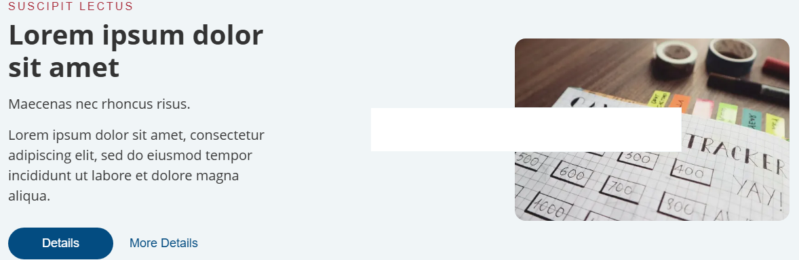

*WithBackgroundImage* (from `/components/promo-cta`)

Notes: Datasource folder is the shared Promos folder.

## AppPromo

Mobile app promotion; title, text and a phone or app image; store badges area.

| | |
|---|---|
| Kind | simple (registry id `app-promo`) |
| Code | `src/components/pagecontent/AppPromo.tsx` |
| Rendering | `/sitecore/layout/Renderings/Project/Financial/Page Content/App Promo` `f9905f6821e84c6f8b8956bb99020d31` |
| Datasource template | `/sitecore/templates/Project/Financial/Components/App Promo` `bbcccd48218c4f19a1d4bb3dbf1f4d89` |
| Datasource location | `query:$site/*[@@name='Data']/*[@@templatename='Promo Folder']` or `query:$sharedSites/*[@@name='Data']/*[@@templatename='Promo Folder']` |
| Can show | 1 image field(s), 0 link field(s), 1 rich text field(s) |
| On the base site | `/`, `/personal`, `/personal/everyday-banking`, `/personal/investing`, `/personal/borrowing` |

**Fields**

| Field | Type | From |
|---|---|---|
| Title | Single-Line Text | App Promo / Data |
| Text | Rich Text | App Promo / Data |
| Image | Image | App Promo / Data |

**Rendering parameters** (layout options, never visitor text): Include in schema

**Variants**

*Default* (from `/components/app-promo`)

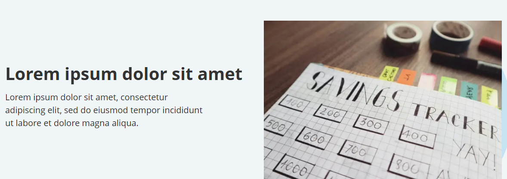

Notes: Datasource folder is the shared Promos folder.

## FiveColumnCta

Five narrow columns with image, text and link; row of categories or products.

| | |
|---|---|
| Kind | simple (registry id `five-column-cta`) |
| Code | `src/components/pagecontent/FiveColumnCta.tsx` |
| Rendering | `/sitecore/layout/Renderings/Project/Financial/Page Content/Five Column CTA` `333def3ec2724ad9a4938d5ccae08312` |
| Datasource template | `/sitecore/templates/Project/Financial/Components/Five Column CTA` `3b41d9fc0edf48e1966ce260339ba815` |
| Datasource location | `query:$site/*[@@name='Data']/*[@@templatename='Promo Folder']` or `query:$sharedSites/*[@@name='Data']/*[@@templatename='Promo Folder']` |
| Can show | 5 image field(s), 5 link field(s), 0 rich text field(s) |
| On the base site | `/` |

**Fields**

| Field | Type | From |
|---|---|---|
| Text1 | Single-Line Text | Five Column CTA / Column 1 |
| Link1 | General Link | Five Column CTA / Column 1 |
| Image1 | Image | Five Column CTA / Column 1 |
| Description1 | Single-Line Text | Five Column CTA / Column 1 |
| Text2 | Single-Line Text | Five Column CTA / Column 2 |
| Link2 | General Link | Five Column CTA / Column 2 |
| Image2 | Image | Five Column CTA / Column 2 |
| Description2 | Single-Line Text | Five Column CTA / Column 2 |
| Text3 | Single-Line Text | Five Column CTA / Column 3 |
| Link3 | General Link | Five Column CTA / Column 3 |
| Image3 | Image | Five Column CTA / Column 3 |
| Description3 | Single-Line Text | Five Column CTA / Column 3 |
| Text4 | Single-Line Text | Five Column CTA / Column 4 |
| Link4 | General Link | Five Column CTA / Column 4 |
| Image4 | Image | Five Column CTA / Column 4 |
| Description4 | Single-Line Text | Five Column CTA / Column 4 |
| Text5 | Single-Line Text | Five Column CTA / Column 5 |
| Link5 | General Link | Five Column CTA / Column 5 |
| Image5 | Image | Five Column CTA / Column 5 |
| Description5 | Single-Line Text | Five Column CTA / Column 5 |

**Template fields the code does not render** (filling them shows nothing): Description1, Description2, Description3, Description4, Description5

**Rendering parameters** (layout options, never visitor text): Include in schema

**Variants**

*Default* (from `/components/five-column-cta`)

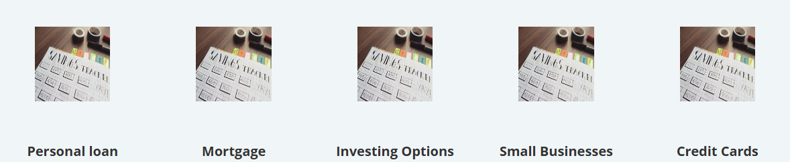

Notes: Datasource folder is the shared Promos folder.

## FourColumnCta

Four columns each with image, title, text and link; four equal options or services.

| | |
|---|---|
| Kind | simple (registry id `four-column-cta`) |
| Code | `src/components/pagecontent/FourColumnCta.tsx` |
| Rendering | `/sitecore/layout/Renderings/Project/Financial/Page Content/Four Column CTA` `35075000760e4ff3bd1cf2eeba251dcb` |
| Datasource template | `/sitecore/templates/Project/Financial/Components/Four Column CTA` `1b694ef9154d429a9c3fd7774cd4a852` |
| Datasource location | `query:$site/*[@@name='Data']/*[@@templatename='Promo Folder']` or `query:$sharedSites/*[@@name='Data']/*[@@templatename='Promo Folder']` |
| Can show | 4 image field(s), 4 link field(s), 0 rich text field(s) |
| On the base site | `/articles`, `/articles/introducing-mobile-finance`, `/articles/beware-of-financial-online-scams`, `/articles/exploring-the-use-of-blockchain-technology`, `/articles/empowering-young-adults` |

**Fields**

| Field | Type | From |
|---|---|---|
| Title1 | Single-Line Text | Four Column CTA / Column 1 |
| Text1 | Single-Line Text | Four Column CTA / Column 1 |
| Link1 | General Link | Four Column CTA / Column 1 |
| Image1 | Image | Four Column CTA / Column 1 |
| Title2 | Single-Line Text | Four Column CTA / Column 2 |
| Text2 | Single-Line Text | Four Column CTA / Column 2 |
| Link2 | General Link | Four Column CTA / Column 2 |
| Image2 | Image | Four Column CTA / Column 2 |
| Title3 | Single-Line Text | Four Column CTA / Column 3 |
| Text3 | Single-Line Text | Four Column CTA / Column 3 |
| Link3 | General Link | Four Column CTA / Column 3 |
| Image3 | Image | Four Column CTA / Column 3 |
| Title4 | Single-Line Text | Four Column CTA / Column 4 |
| Text4 | Single-Line Text | Four Column CTA / Column 4 |
| Link4 | General Link | Four Column CTA / Column 4 |
| Image4 | Image | Four Column CTA / Column 4 |

**Rendering parameters** (layout options, never visitor text): Include in schema

**Variants**

*Default* (from `/components/four-column-cta`)

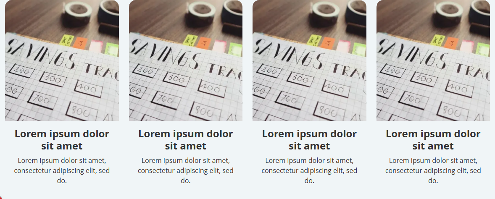

Notes: Datasource folder is the shared Promos folder.

## ThreeColumnCta

Three columns with image or icon; short text and sub text per column; link per column.

| | |
|---|---|
| Kind | simple (registry id `three-column-cta`) |
| Code | `src/components/pagecontent/ThreeColumnCta.tsx` |
| Rendering | `/sitecore/layout/Renderings/Project/Financial/Page Content/Three Column CTA` `ad385021ce2b4fc189aa207d408034a8` |
| Datasource template | `/sitecore/templates/Project/Financial/Components/Three Column CTA` `148d07baf9234fb289070bd440d5db44` |
| Datasource location | `query:$site/*[@@name='Data']/*[@@templatename='Promo Folder']` or `query:$sharedSites/*[@@name='Data']/*[@@templatename='Promo Folder']` |
| Can show | 3 image field(s), 3 link field(s), 0 rich text field(s) |
| On the base site | `/`, `/personal`, `/business`, `/retirement-planning`, `/get-a-loan` |

**Fields**

| Field | Type | From |
|---|---|---|
| Text1 | Single-Line Text | Three Column CTA / Column 1 |
| Video1 | File | Three Column CTA / Column 1 |
| SubText1 | Single-Line Text | Three Column CTA / Column 1 |
| Link1 | General Link | Three Column CTA / Column 1 |
| Image1 | Image | Three Column CTA / Column 1 |
| Text2 | Single-Line Text | Three Column CTA / Column 2 |
| Video2 | File | Three Column CTA / Column 2 |
| SubText2 | Single-Line Text | Three Column CTA / Column 2 |
| Link2 | General Link | Three Column CTA / Column 2 |
| Image2 | Image | Three Column CTA / Column 2 |
| Text3 | Single-Line Text | Three Column CTA / Column 3 |
| Video3 | File | Three Column CTA / Column 3 |
| SubText3 | Single-Line Text | Three Column CTA / Column 3 |
| Link3 | General Link | Three Column CTA / Column 3 |
| Image3 | Image | Three Column CTA / Column 3 |

**Template fields the code does not render** (filling them shows nothing): Video1, Video2, Video3

**Rendering parameters** (layout options, never visitor text): ButtonStyle, Include in schema

**Variants**

*Default* (from `/components/three-column-cta`)

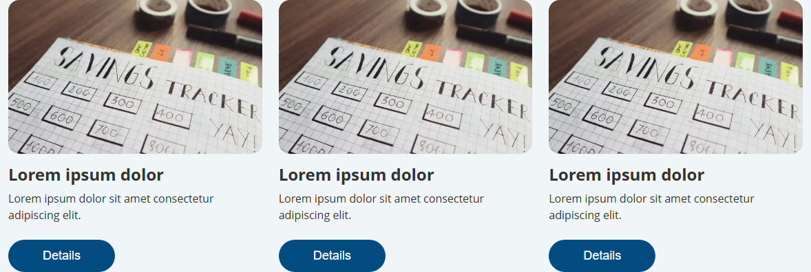

*WithIcons* (from `/components/three-column-cta`)

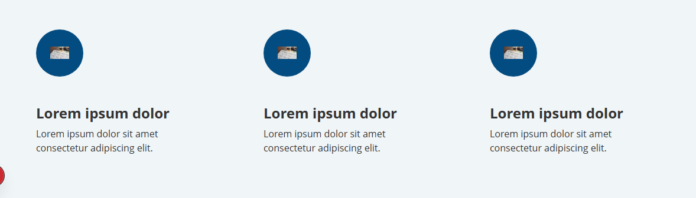

*WithIconsCompact* (from `/components/three-column-cta`)

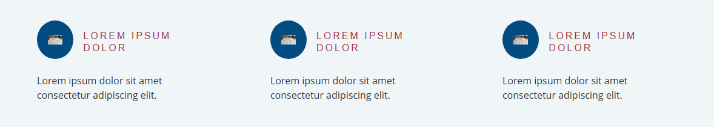

Notes: Datasource folder is the shared Promos folder.

## TwoColumnCta

Two cards side by side; each with image, title, text and link; two equal options.

| | |
|---|---|
| Kind | simple (registry id `two-column-cta`) |
| Code | `src/components/pagecontent/TwoColumnCta.tsx` |
| Rendering | `/sitecore/layout/Renderings/Project/Financial/Page Content/Two Column CTA` `3a9a9d22c0924b549511eb202ceabe8d` |
| Datasource template | `/sitecore/templates/Project/Financial/Components/Two Column CTA` `1812bf3e6bdd466d99b20d7cebb020fc` |
| Datasource location | `query:$site/*[@@name='Data']/*[@@templatename='Promo Folder']` or `query:$sharedSites/*[@@name='Data']/*[@@templatename='Promo Folder']` |
| Can show | 2 image field(s), 2 link field(s), 0 rich text field(s) |
| On the base site | `/`, `/personal/borrowing`, `/get-a-loan` |

**Fields**

| Field | Type | From |
|---|---|---|
| Title1 | Single-Line Text | Two Column CTA / Column 1 |
| Text1 | Single-Line Text | Two Column CTA / Column 1 |
| Link1 | General Link | Two Column CTA / Column 1 |
| Image1 | Image | Two Column CTA / Column 1 |
| Title2 | Single-Line Text | Two Column CTA / Column 2 |
| Text2 | Single-Line Text | Two Column CTA / Column 2 |
| Link2 | General Link | Two Column CTA / Column 2 |
| Image2 | Image | Two Column CTA / Column 2 |

**Rendering parameters** (layout options, never visitor text): ButtonStyle, Include in schema

**Placeholders** (other components can be added inside it in Pages; empty, they show only while editing, not in the screenshots)

- `two-col-placeholder-left`: every variant
- `two-col-placeholder-right`: every variant

**Variants**

*Default* (from `/components/two-column-cta`)

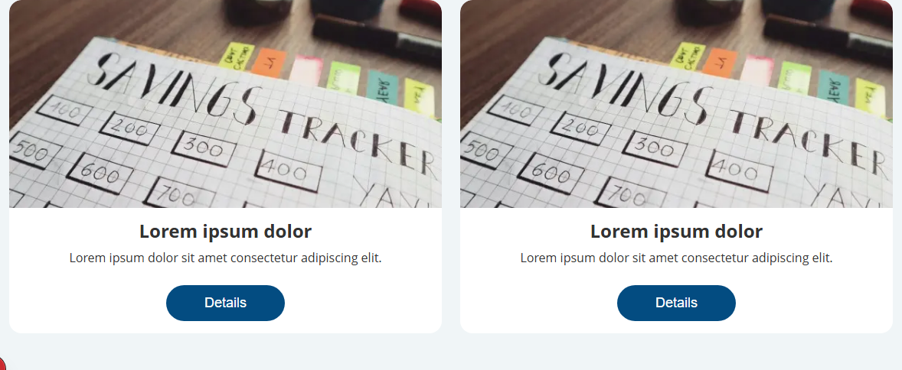

Notes: Datasource folder is the shared Promos folder.

## Comparison

Two amounts or offers side by side; currency, subtitle and value per side; before and after figures.

| | |
|---|---|
| Kind | simple (registry id `comparison`) |
| Code | `src/components/pagecontent/Comparison.tsx` |
| Rendering | `/sitecore/layout/Renderings/Project/Financial/Page Content/Comparison` `20e5ea956b5049cd8852433b7c565f06` |
| Datasource template | `/sitecore/templates/Project/Financial/Components/Comparison` `32f0042821ac4dc0aa2bf2e31ca3e97e` |
| Datasource location | `query:$site/*[@@name='Data']/*[@@templatename='Comparison']` or `query:$sharedSites/*[@@name='Data']/*[@@templatename='Comparison']` |
| Can show | 0 image field(s), 0 link field(s), 0 rich text field(s) |
| On the base site | `/get-a-loan` |

**Fields**

| Field | Type | From |
|---|---|---|
| Title1 | Single-Line Text | Comparison / Title |
| Amount1 | Single-Line Text | Comparison / Item 1 |
| Currency1 | Single-Line Text | Comparison / Item 1 |
| Subtitle1 | Single-Line Text | Comparison / Item 1 |
| Value1 | Single-Line Text | Comparison / Operator |
| Amount2 | Single-Line Text | Comparison / Item 2 |
| Currency2 | Single-Line Text | Comparison / Item 2 |
| Subtitle2 | Single-Line Text | Comparison / Item 2 |

**Rendering parameters** (layout options, never visitor text): Include in schema

**Variants**

*Default* (from `/components/comparison`)

## DocumentsList

List of downloadable documents; title, subtitle, icon image and link per document; up to four items.

| | |
|---|---|
| Kind | simple (registry id `documents-list`) |
| Code | `src/components/pagecontent/DocumentsList.tsx` |
| Rendering | `/sitecore/layout/Renderings/Project/Financial/Page Content/Documents List` `ccc3a8155de94529bad5874548667d66` |
| Datasource template | `/sitecore/templates/Project/Financial/Components/Documents List` `bc79b430f5e0436383f85fb8ccd79c61` |
| Datasource location | `query:$site/*[@@name='Data']/*[@@templatename='Documents List']` or `query:$sharedSites/*[@@name='Data']/*[@@templatename='Documents List']` |
| Can show | 4 image field(s), 4 link field(s), 0 rich text field(s) |
| On the base site | `/` |

**Fields**

| Field | Type | From |
|---|---|---|
| Title1 | Single-Line Text | Documents List / Title |
| Subtitle1 | Single-Line Text | Documents List / Item 1 |
| Link1 | General Link | Documents List / Item 1 |
| Image1 | Image | Documents List / Item 1 |
| Subtitle2 | Single-Line Text | Documents List / Item 2 |
| Link2 | General Link | Documents List / Item 2 |
| Image2 | Image | Documents List / Item 2 |
| Subtitle3 | Single-Line Text | Documents List / Item 3 |
| Link3 | General Link | Documents List / Item 3 |
| Image3 | Image | Documents List / Item 3 |
| Subtitle4 | Single-Line Text | Documents List / Item 4 |
| Link4 | General Link | Documents List / Item 4 |
| Image4 | Image | Documents List / Item 4 |

**Rendering parameters** (layout options, never visitor text): Include in schema

**Variants**

*Default* (from `/components/documents-list`)

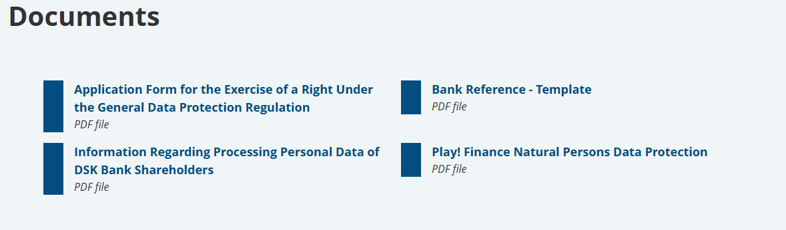

## Features

Feature section with eyebrow, rich text, link and image; two titled feature text blocks.

| | |
|---|---|
| Kind | simple (registry id `features`) |
| Code | `src/components/pagecontent/Features.tsx` |
| Rendering | `/sitecore/layout/Renderings/Project/Financial/Page Content/Features` `b7efffdb2f0c4c5ea8bed9f8677f01da` |
| Datasource template | `/sitecore/templates/Project/Financial/Components/Features` `d3fdded944ae4410961c3320cc82d638` |
| Datasource location | `query:$site/*[@@name='Data']/*[@@templatename='Features']` or `query:$sharedSites/*[@@name='Data']/*[@@templatename='Features']` |
| Can show | 1 image field(s), 1 link field(s), 1 rich text field(s) |

**Fields**

| Field | Type | From |
|---|---|---|
| Eyebrow | Single-Line Text | Features / Data |
| Text | Rich Text | Features / Data |
| Link | General Link | Features / Data |
| Image1 | Image | Features / Column 1 |
| Title1 | Single-Line Text | Features / Column 1 |
| Text1 | Single-Line Text | Features / Column 1 |
| Image2 | Image | Features / Column 2 |
| Title2 | Single-Line Text | Features / Column 2 |
| Text2 | Single-Line Text | Features / Column 2 |

**Template fields the code does not render** (filling them shows nothing): Image2

**Rendering parameters** (layout options, never visitor text): Include in schema

**Variants**

*Default* (from `/components/features`)

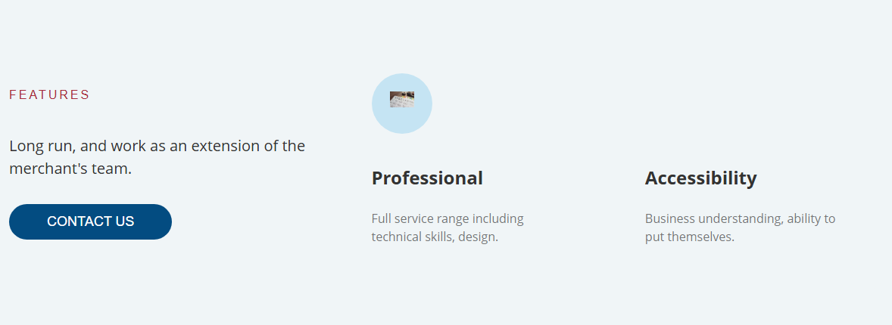

Notes: Sections read: Data, Column 1, Column 2.

## ImageGallery

Image or photo block; full-width picture.

| | |
|---|---|
| Kind | list (registry id `image-gallery`) |
| Code | `src/components/pagecontent/ImageGallery.tsx` |
| Rendering | `/sitecore/layout/Renderings/Project/Financial/Page Content/Image Gallery` `881ce560277e47b685bea223348d69ca` |
| Datasource template | `/sitecore/templates/Project/Financial/Components/Image Gallery` `bd5988c088ea4e5d8cbaa88755dd0fb8` |
| Datasource location | `query:$site/*[@@name='Data']/*[@@templatename='Image Gallery']` or `query:$sharedSites/*[@@name='Data']/*[@@templatename='Image Gallery']` |
| Can show | 1 image field(s), 0 link field(s), 0 rich text field(s), a list of child items |

**Fields read by the code** (no datasource template): Image (ImageField)

**Child items: Image** (`/sitecore/templates/Feature/JSS Experience Accelerator/Media/Image`)

| Field | Type |
|---|---|
| Image | Image |
| TargetUrl | General Link |
| ImageCaption | Single-Line Text |

**Template fields the code does not render** (filling them shows nothing): TargetUrl, ImageCaption

**Rendering parameters** (layout options, never visitor text): Include in schema

**Variants**

*Default* (from `/components/image-gallery`)

Notes: Candidate local template {BD5988C0-88EA-4E5D-8CBA-A88755DD0FB8} has only an empty standard values item and no fields. Children resolver {2F5C334E-5615-423C-8281-9FC180191302}. Kind left simple because no child template was found.

## Quote

Single quotation with author name, position and photo.

| | |
|---|---|
| Kind | simple (registry id `quote`) |
| Code | `src/components/pagecontent/Quote.tsx` |
| Rendering | `/sitecore/layout/Renderings/Project/Financial/Page Content/Quote` `4b94b6d0ca8e4807bb9a4c3fbd21504c` |
| Datasource template | `/sitecore/templates/Project/Financial/Components/Quote` `cad49c2abd8544fd852a10c1a1c8fd72` |
| Datasource location | `query:$site/*[@@name='Data']/*[@@templatename='Quote']` or `query:$sharedSites/*[@@name='Data']/*[@@templatename='Quote']` |
| Can show | 1 image field(s), 0 link field(s), 0 rich text field(s) |

**Fields**

| Field | Type | From |
|---|---|---|
| Quote | Multi-Line Text | Quote / Data |
| AuthorName | Single-Line Text | Quote / Data |
| AuthorPosition | Single-Line Text | Quote / Data |
| Image | Image | Quote / Data |

**Rendering parameters** (layout options, never visitor text): Include in schema

**Variants**

*Default* (from `/components/quote`)

*Simple* (from `/components/quote`)

Notes: Code variant Simple has no Variant Definition. Standard values expose Quote, AuthorName, AuthorPosition, Image.

## RichText

Plain heading and body copy; text-only section.

| | |
|---|---|
| Kind | simple (registry id `rich-text`) |
| Code | `src/components/pagecontent/RichText.tsx` |
| Rendering | `/sitecore/layout/Renderings/Feature/JSS Experience Accelerator/Page Content/RichText` `9c6d53e3fe574638af7b6d68304c7a94` |
| Datasource template | `/sitecore/templates/Feature/JSS Experience Accelerator/Page Content/Text` `0a7aa3735ed14e9b967822d3c5faf6df` |
| Datasource location | `query:$site/*[@@name='Data']/*[@@templatename='Text Folder']` or `query:$sharedSites/*[@@name='Data']/*[@@templatename='Text Folder']` |
| Can show | 0 image field(s), 0 link field(s), 1 rich text field(s) |
| On the base site | `/`, `/personal`, `/personal/everyday-banking`, `/personal/investing`, `/personal/borrowing` |

**Fields**

| Field | Type | From |
|---|---|---|
| Text | Rich Text | Text / Text |

**Rendering parameters** (layout options, never visitor text): Include in schema

**Variants**

*Default* (from `/components/accordion`)

Notes: Json rendering lives outside the Financial project layer. Text template has no standard values child. Field type read from the Text field item.

## StatsCounter

Row of three large numbers with symbols and captions; animated counting numbers; supporting images.

| | |
|---|---|
| Kind | simple (registry id `stats-counter`) |
| Code | `src/components/pagecontent/StatsCounter.tsx` |
| Rendering | `/sitecore/layout/Renderings/Project/Financial/Page Content/Stats Counter` `316889fafdd442a6a034201124fe54e8` |
| Datasource template | `/sitecore/templates/Project/Financial/Components/Stats Counter` `c24bfc74c6e2413aaebd903180dfaff7` |
| Datasource location | `query:$site/*[@@name='Data']/*[@@templatename='Stats Counter']` or `query:$sharedSites/*[@@name='Data']/*[@@templatename='Stats Counter']` |
| Can show | 2 image field(s), 0 link field(s), 0 rich text field(s) |

**Fields**

| Field | Type | From |
|---|---|---|
| Image1 | Image | Stats Counter / Data |
| Image2 | Image | Stats Counter / Data |
| Value1 | Number | Stats Counter / Column 1 |
| Symbol1 | Single-Line Text | Stats Counter / Column 1 |
| Caption1 | Single-Line Text | Stats Counter / Column 1 |
| Value2 | Number | Stats Counter / Column 2 |
| Symbol2 | Single-Line Text | Stats Counter / Column 2 |
| Caption2 | Single-Line Text | Stats Counter / Column 2 |
| Value3 | Number | Stats Counter / Column 3 |
| Symbol3 | Single-Line Text | Stats Counter / Column 3 |
| Caption3 | Single-Line Text | Stats Counter / Column 3 |

**Rendering parameters** (layout options, never visitor text): Include in schema

**Variants**

*Default* (from `/components/stats-counter`)

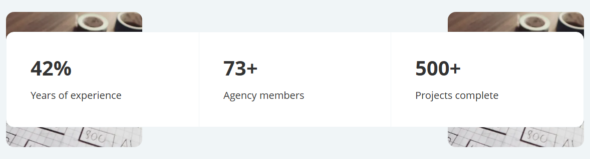

## ApplicationForm

Application form with name, ID number, email and mobile number; submit button and footnote.

| | |
|---|---|
| Kind | simple (registry id `application-form`) |
| Code | `src/components/utilities/ApplicationForm.tsx` |
| Rendering | `/sitecore/layout/Renderings/Project/Financial/Utilities/Application Form` `e4b51f7cef5d4621a05ba0080826e54d` |
| Datasource template | `/sitecore/templates/Project/Financial/Components/Application Form` `ae920ce65c6e4842b54ce4b516dc0752` |
| Datasource location | `query:$site/*[@@name='Data']/*[@@templatename='Application Form']` or `query:$sharedSites/*[@@name='Data']/*[@@templatename='Application Form']` |
| Can show | 0 image field(s), 1 link field(s), 2 rich text field(s) |
| On the base site | `/get-a-loan` |

**Fields**

| Field | Type | From |
|---|---|---|
| Title | Single-Line Text | Application Form / Data |
| Subtitle | Rich Text | Application Form / Data |
| FullName | Single-Line Text | Application Form / Data |
| IDNumber | Single-Line Text | Application Form / Data |
| Email | Single-Line Text | Application Form / Data |
| MobileNumber | Single-Line Text | Application Form / Data |
| Footnote | Rich Text | Application Form / Data |
| SubmitButton | General Link | Application Form / Data |

**Rendering parameters** (layout options, never visitor text): Include in schema

**Variants**

*Default* (from `/components/application-form`)

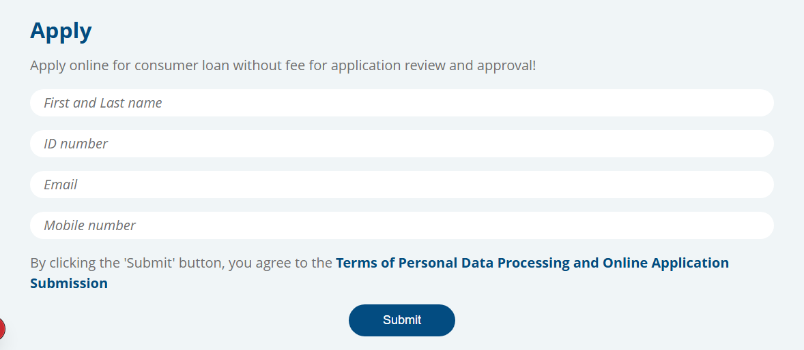

## ContactForm

Contact form with email, subject and message; submit button; optional background image.

| | |
|---|---|
| Kind | simple (registry id `contact-form`) |
| Code | `src/components/utilities/ContactForm.tsx` |
| Rendering | `/sitecore/layout/Renderings/Project/Financial/Utilities/Contact Form` `09530d1f141d48858b3eebca3ea5a23e` |
| Datasource template | `/sitecore/templates/Project/Financial/Components/Contact Form` `6d166c16d4cc4ba9b1e1fe6378916533` |
| Datasource location | `query:$site/*[@@name='Data']/*[@@templatename='Contact Form']` or `query:$sharedSites/*[@@name='Data']/*[@@templatename='Contact Form']` |
| Can show | 1 image field(s), 0 link field(s), 0 rich text field(s) |

**Fields**

| Field | Type | From |
|---|---|---|
| Title | Single-Line Text | Contact Form / Data |
| EmailLabel | Single-Line Text | Contact Form / Data |
| SubjectLabel | Single-Line Text | Contact Form / Data |
| MessageLabel | Single-Line Text | Contact Form / Data |
| ButtonLabel | Single-Line Text | Contact Form / Data |
| BackgroundImage | Image | Contact Form / Data |

**Rendering parameters** (layout options, never visitor text): Include in schema

**Variants**

*Default* (from `/components/contact-form`)

## LoanCalculator

Calculator with amount and term sliders; interest and fee based result; financial services.

| | |
|---|---|
| Kind | simple (registry id `loan-calculator`) |
| Code | `src/components/utilities/LoanCalculator.tsx` |
| Rendering | `/sitecore/layout/Renderings/Project/Financial/Utilities/Loan Calculator` `a9598b4014d547fcb1830b9ff10b90d3` |
| Datasource template | `/sitecore/templates/Project/Financial/Components/Loan Calculator` `8a299404ec7c4bc284c5b6f4c5af6121` |
| Datasource location | `query:$site/*[@@name='Data']/*[@@templatename='Loan Calculator']` or `query:$sharedSites/*[@@name='Data']/*[@@templatename='Loan Calculator']` |
| Can show | 0 image field(s), 0 link field(s), 0 rich text field(s) |
| On the base site | `/get-a-loan` |

**Fields**

| Field | Type | From |
|---|---|---|
| MinAmount | Integer | Loan Calculator / Data |
| MaxAmount | Integer | Loan Calculator / Data |
| Currency | Single-Line Text | Loan Calculator / Data |
| MinTerm | Integer | Loan Calculator / Data |
| MaxTerm | Integer | Loan Calculator / Data |
| TermName | Single-Line Text | Loan Calculator / Data |
| InterestRate | Number | Loan Calculator / Data |
| BankFee | Number | Loan Calculator / Data |

**Rendering parameters** (layout options, never visitor text): Include in schema

**Variants**

*Default* (from `/components/loan-calculator`)

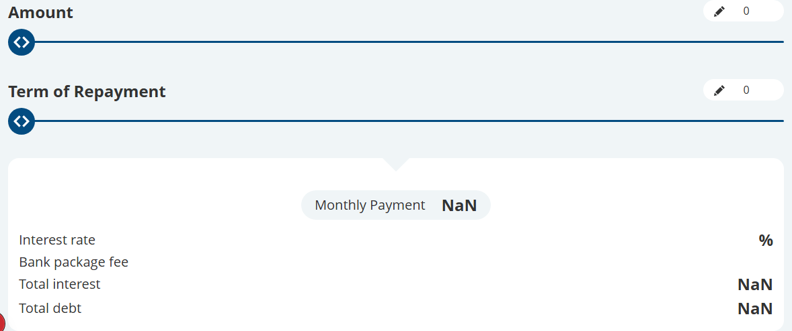

## Accordion

Expandable and collapsible panels; click to open items.

| | |
|---|---|
| Kind | list (registry id `accordion`) |
| Code | `src/components/pagecontent/Accordion.tsx` |
| Rendering | `/sitecore/layout/Renderings/Project/Financial/Page Content/Accordion` `5816f979c8bb46e98ec8513c6caf41e6` |
| Datasource template | `/sitecore/templates/Project/Financial/Components/Accordion` `9bc52f2ffeed47dc88ec1946fa308af0` |
| Datasource location | `query:$site/*[@@name='Data']/*[@@templatename='Accordion']` or `query:$sharedSites/*[@@name='Data']/*[@@templatename='Accordion']` |
| Can show | 1 image field(s), 0 link field(s), 1 rich text field(s), a list of child items |

**Fields read by the code** (no datasource template): Icon (ImageField), Title (Field<string>), Content (Field<string>)

**Child items: Accordion Item** (`/sitecore/templates/Project/Financial/Components/Accordion Item`)

| Field | Type |
|---|---|
| Icon | Image |
| Title | Single-Line Text |
| Content | Rich Text |

**Rendering parameters** (layout options, never visitor text): Include in schema

**Variants**

*Default* (from `/components/accordion`)

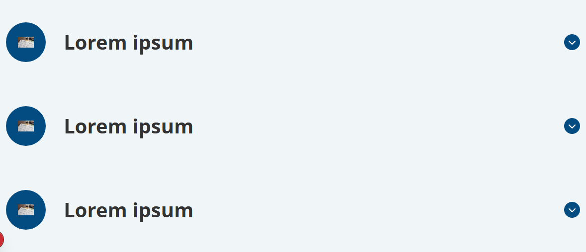

Notes: Candidate local template /sitecore/templates/Project/Financial/Components/Accordion {9BC52F2F-FEED-47DC-88EC-1946FA308AF0} has no Data section. Candidate child template Accordion Item {02FC3E8B-A97F-4A7A-844B-3047E24432A0} was not linked because the branch item is missing. Children resolver {2F5C334E-5615-423C-8281-9FC180191302}.

## ArticleList

Cards for articles or blog posts; thumbnail, title, excerpt and author; grid or list of news.

| | |
|---|---|
| Kind | context (registry id `article-list`) |
| Code | `src/components/pagecontent/ArticleList.tsx` |
| Rendering | `/sitecore/layout/Renderings/Project/Financial/Articles/Article List` `527335926f5d4fb480039b8223c5bc76` |
| Datasource template | none (reads the page or its children) |
| Datasource location | `query:$site/*` |
| Can show | 0 image field(s), 0 link field(s), 0 rich text field(s) |
| On the base site | `/`, `/articles` |

**Fields read by the code** (no datasource template): Title (Field<string>), Excerpt (Field<string>), Content (RichTextField), Thumbnail (ImageField), BackgroundImage (ImageField), Name (Field<string>), Photo (ImageField), Position (Field<string>)

**Rendering parameters** (layout options, never visitor text): NumberOfItems, Include in schema

**Variants**

*Default* (from `/articles`)

*ThreeColumn*: not placed on the base site, no screenshot

*Simplified* (from `/`)

*Grid*: not placed on the base site, no screenshot

Notes: No datasource template. Children resolver {2F5C334E-5615-423C-8281-9FC180191302}. Datasource location is query:$site/*.

## AuthorList

People or authors list; photo, name, position and bio; team members.

| | |
|---|---|
| Kind | context (registry id `author-list`) |
| Code | `src/components/pagecontent/AuthorList.tsx` |
| Rendering | `/sitecore/layout/Renderings/Project/Financial/Articles/Author List` `69e8a90f59ca4638b53ebdce65835230` |
| Datasource template | none (reads the page or its children) |
| Can show | 0 image field(s), 0 link field(s), 0 rich text field(s) |
| On the base site | `/authors` |

**Fields read by the code** (no datasource template): Name (Field<string>), Photo (ImageField), Bio (RichTextField), Position (Field<string>)

**Rendering parameters** (layout options, never visitor text): Include in schema

**Variants**

*Default* (from `/authors`)

*Slider*: not placed on the base site, no screenshot

*Simple*: not placed on the base site, no screenshot

Notes: No datasource template. Children resolver {2F5C334E-5615-423C-8281-9FC180191302}. Code variants Slider and Simple have no Variant Definition.

## AuthorWidget

Single person card with photo, name and position; social media links.

| | |
|---|---|
| Kind | simple (registry id `author-widget`) |
| Code | `src/components/pagecontent/AuthorWidget.tsx` |
| Rendering | `/sitecore/layout/Renderings/Project/Financial/Articles/Author Widget` `9d7de58d9da443d883713c728a582adc` |
| Datasource template | `/sitecore/templates/Project/Financial/Pages/Author Page` `aad350f593314d71a942e3643653c028` |
| Datasource location | `query:$site/Home/authors` |
| Can show | 4 image field(s), 3 link field(s), 0 rich text field(s) |
| On the base site | `/articles/introducing-mobile-finance`, `/articles/beware-of-financial-online-scams`, `/articles/exploring-the-use-of-blockchain-technology`, `/articles/empowering-young-adults`, `/articles/closing-the-wealth-gap` |

**Fields**

| Field | Type | From |
|---|---|---|
| Name | Single-Line Text | Author Page / Content |
| Position | Single-Line Text | Author Page / Content |
| Photo | Image | Author Page / Content |
| Bio | Rich Text | Author Page / Content |
| BackgroundImage | Image | Author Page / Content |
| SocialLink1 | General Link | Author Page / Socials |
| SocialIcon1 | Image | Author Page / Socials |
| SocialLink2 | General Link | Author Page / Socials |
| SocialIcon2 | Image | Author Page / Socials |
| SocialLink3 | General Link | Author Page / Socials |
| SocialIcon3 | Image | Author Page / Socials |
| baseMetadataTitle | Single-Line Text | _Base Site Metadata / Metadata |
| baseMetadataKeywords | Single-Line Text | _Base Site Metadata / Metadata |
| baseMetadataDescription | Multi-Line Text | _Base Site Metadata / Metadata |
| baseMetadataAuthor | Single-Line Text | _Base Site Metadata / Metadata |
| baseOgTitle | Single-Line Text | _Base Open Graph / Open Graph |
| baseOgDescription | Multi-Line Text | _Base Open Graph / Open Graph |
| baseOgImage | Image | _Base Open Graph / Open Graph |
| baseOgType | Single-Line Text | _Base Open Graph / Open Graph |
| NavigationTitle | Single-Line Text | _Navigable / Navigation |
| NavigationFilter | Checklist | _Navigable / Navigation |
| NavigationClass | Droplink | _Navigable / Navigation |
| ChangeFrequency | Droplink | _Sitemap / Sitemap Settings |
| Priority | Droplink | _Sitemap / Sitemap Settings |
| SxaTags | Tag Treelist | _Taggable / Tagging |
| Page Design | Droplink | _Designable / Designing |

**Template fields the code does not render** (filling them shows nothing): Bio, BackgroundImage, baseMetadataTitle, baseMetadataKeywords, baseMetadataDescription, baseMetadataAuthor, baseOgTitle, baseOgDescription, baseOgImage, baseOgType, NavigationTitle, NavigationFilter, NavigationClass, ChangeFrequency, Priority, SxaTags, Page Design

**Rendering parameters** (layout options, never visitor text): Include in schema

**Variants**

*Default* (from `/components/author-widget`)

*WithSocials* (from `/components/author-widget`)

Notes: Datasource template is the Author Page route template, not a component template. Sections read: Content, Socials. Code variant WithSocials has no Variant Definition. Resolver {3DF775BF-3F56-446F-9D81-43DE64DA4DDA}.

## ProjectList

Case studies or projects; thumbnail, client logo, category and abstract; problem and solution summary.

| | |
|---|---|
| Kind | context (registry id `project-list`) |
| Code | `src/components/pagecontent/ProjectList.tsx` |
| Rendering | `/sitecore/layout/Renderings/Project/Financial/Projects/Project List` `3f98b12e969347d6850718b054ccfb8e` |
| Datasource template | none (reads the page or its children) |
| Datasource location | `query:$site/*` |
| Can show | 0 image field(s), 0 link field(s), 0 rich text field(s) |

**Fields read by the code** (no datasource template): Title (Field<string>), Category (Field<string>), Abstract (Field<string>), Problem (RichTextField), Solution (RichTextField), Thumbnail (ImageField), Client (ImageField)

**Rendering parameters** (layout options, never visitor text): NumberOfItems, ShowFilters, Include in schema

**Variants**

*Default*: not placed on the base site, no screenshot

*Mosaic*: not placed on the base site, no screenshot

Notes: No datasource template. Children resolver {2F5C334E-5615-423C-8281-9FC180191302}. Code variant Mosaic has no Variant Definition.

## Questions

Frequently asked questions; question and answer list.

| | |
|---|---|
| Kind | list (registry id `questions`) |
| Code | `src/components/pagecontent/Questions.tsx` |
| Rendering | `/sitecore/layout/Renderings/Project/Financial/Page Content/Questions` `75464a5ecbb74f96bbbc104afe57923a` |
| Datasource template | `/sitecore/templates/Project/Financial/Components/Questions` `fae81bf911174f97913300e752f41772` |
| Datasource location | `query:$site/*[@@name='Data']/*[@@templatename='Questions']` or `query:$sharedSites/*[@@name='Data']/*[@@templatename='Questions']` |
| Can show | 0 image field(s), 0 link field(s), 1 rich text field(s), a list of child items |
| On the base site | `/personal`, `/business`, `/retirement-planning`, `/get-a-loan` |

**Fields read by the code** (no datasource template): Question (Field<string>), Answer (Field<string>)

**Child items: Question** (`/sitecore/templates/Project/Financial/Components/Question`)

| Field | Type |
|---|---|
| Question | Single-Line Text |
| Answer | Rich Text |

**Rendering parameters** (layout options, never visitor text): Include in schema

**Variants**

*Default* (from `/components/questions`)

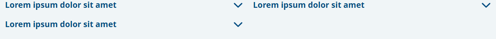

*SingleColumn* (from `/components/questions`)

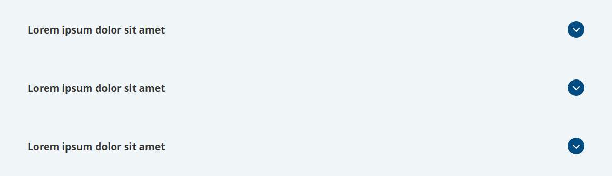

Notes: Candidate local template {FAE81BF9-1117-4F97-9133-00E752F41772} and candidate child Question {2DC7A13E-6753-47EF-805A-1CDE39012EEC} were not assigned because the branch item is missing. Code variant SingleColumn has no Variant Definition. Children resolver {2F5C334E-5615-423C-8281-9FC180191302}.

## Testimonials

Several customer quotes; slider or row of testimonials.

| | |
|---|---|
| Kind | list (registry id `testimonials`) |
| Code | `src/components/pagecontent/Testimonials.tsx` |
| Rendering | `/sitecore/layout/Renderings/Project/Financial/Page Content/Testimonials` `f3766b60c8ce49af9bfeb2cee6e287df` |
| Datasource template | `/sitecore/templates/Project/Financial/Components/Testimonials` `91cd4de0ed0b457b9936a333e8a874a3` |
| Datasource location | `query:$site/*[@@name='Data']/*[@@templatename='Testimonials']` or `query:$sharedSites/*[@@name='Data']/*[@@templatename='Testimonials']` |
| Can show | 1 image field(s), 0 link field(s), 0 rich text field(s), a list of child items |

**Fields read by the code** (no datasource template): Rating (Field<string>), Content (Field<string>), AuthorName (Field<string>), AuthorPosition (Field<string>), AuthorImage (ImageField)

**Child items: Testimonial** (`/sitecore/templates/Project/Financial/Components/Testimonial`)

| Field | Type |
|---|---|
| Rating | Number |
| Content | Multi-Line Text |
| AuthorName | Single-Line Text |
| AuthorPosition | Single-Line Text |
| AuthorImage | Image |

**Rendering parameters** (layout options, never visitor text): Include in schema

**Variants**

*Default* (from `/components/testimonials`)

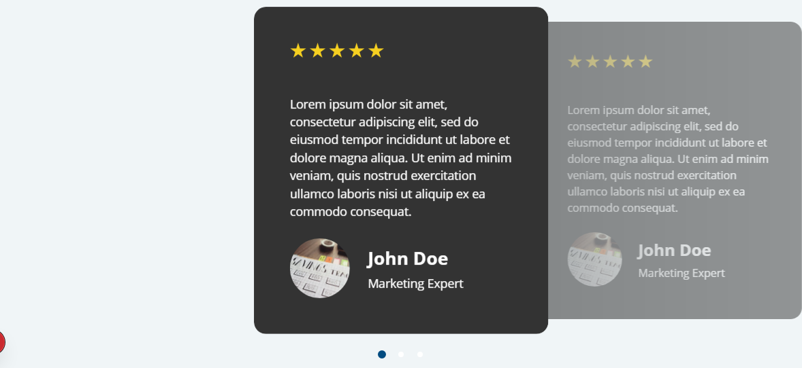

Notes: Candidate local template {91CD4DE0-ED0B-457B-9936-A333E8A874A3} and candidate child Testimonial {40472280-0A67-4C52-A06B-79E327AF9F44} were not assigned because the branch item is missing. Children resolver {2F5C334E-5615-423C-8281-9FC180191302}.

## ProjectDetails

| | |
|---|---|
| Kind | context |
| Code | `src/components/pagecontent/ProjectDetails.tsx` |
| Rendering | `/sitecore/layout/Renderings/Project/Financial/Projects/Project Details` `7d1264b8dbea4dcd8b2c5db934359ea9` |
| Datasource template | none (reads the page or its children) |
| Can show | 0 image field(s), 0 link field(s), 0 rich text field(s) |

**Fields read by the code** (no datasource template): Title (Field<string>), Abstract (Field<string>), Category (Field<string>), Client (ImageField), Problem (RichTextField), Solution (RichTextField), Thumbnail (ImageField)

**Rendering parameters** (layout options, never visitor text): Include in schema

**Placeholders** (other components can be added inside it in Pages; empty, they show only while editing, not in the screenshots)

- `project-additional-content` (after Problem, before Solution): every variant

**Variants**

*Default*: not placed on the base site, no screenshot

Notes: Context item resolver {6CCCBCDE-5E95-44E4-AE66-CFE7D3A0589E}.

